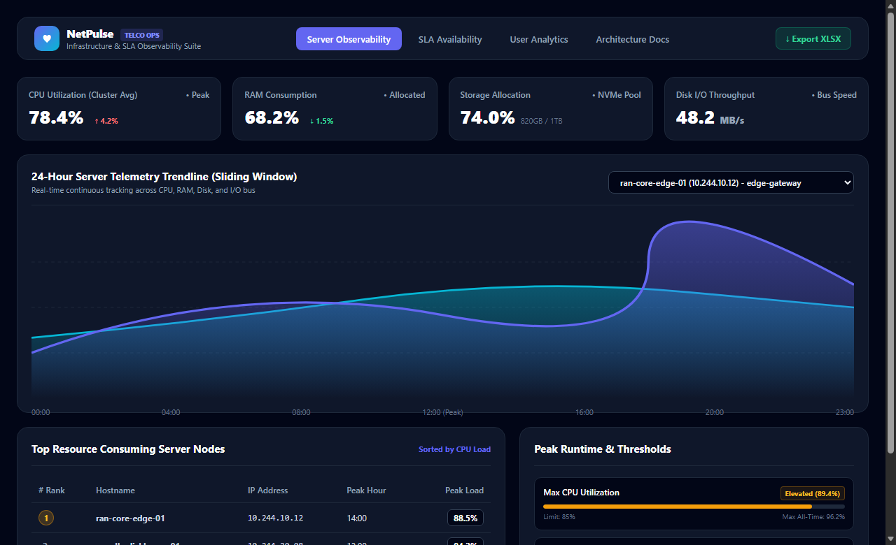
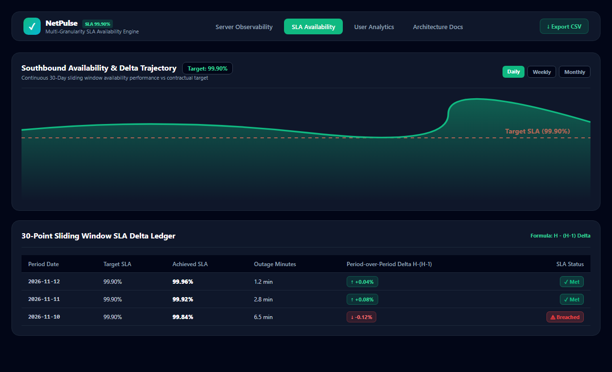
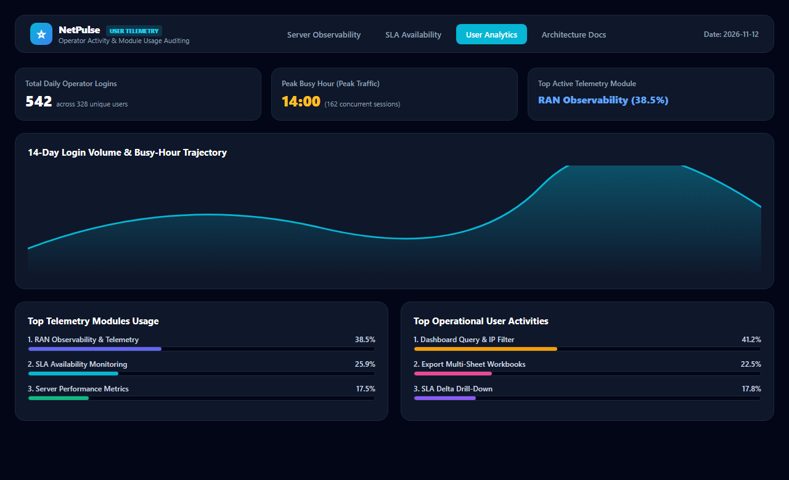

# NetPulse &mdash; Infrastructure Observability & SLA Monitoring Dashboard

[](https://react.dev/)
[](https://www.typescriptlang.org/)
[](https://tailwindcss.com/)
[](https://recharts.org/)
[](https://vitest.dev/)
[](LICENSE)

A production-grade **telecommunication infrastructure observability and SLA availability dashboard** built with modern React 18, TypeScript, and interactive telemetry visualization. Engineered by **[Eureka Robby Harianja](https://github.com/EurekaRobbyH)** based on 2 years of hands-on production monitoring experience.

---

## 📸 Visual Showcase & Dashboard Previews

### 🖥️ 1. Server Infrastructure Observability
> High-density 24-hour telemetry tracking across **CPU Load, RAM Consumption, Disk Allocation, and Disk I/O Throughput** with interactive cluster node filtering, top-consumer ranking, and peak threshold status cards.

<p align="center">
  
</p>

---

### 🛡️ 2. SLA Availability & Period-over-Period Delta Ledger
> Multi-granularity availability tracking across **Daily, Weekly, and Monthly** intervals with dual-stream monitoring (**Southbound & Northbound**) and real-time period-over-period delta audits ($H - (H-1)$).

<p align="center">
  
</p>

---

### 👥 3. User Telemetry & Access Auditing
> Trajectory tracking of 14-day login volume, busy-hour activity peaks, and distribution across core observability modules.

<p align="center">
  
</p>

---

## 🌟 Key Features

### 1. 🖥️ Server Infrastructure Observability
- **24-Hour Telemetry Trends:** Multi-metric tracking across **CPU Load, RAM Consumption, Disk Allocation, and Disk I/O Throughput (Reads/Writes)**.
- **Node Filtering:** Instant switching across cluster nodes (Edge Gateways, Database Clusters, Ingress Proxies) by IP address and hostname.
- **Top Resource Ranking:** Real-time top-consumer tables with sorting by CPU, RAM, Disk, and I/O.
- **Peak Runtime Analysis:** Threshold tracking with automatic status badges (*Normal*, *Elevated*, *Critical*).

### 2. 🛡️ SLA Availability Engine
- **Multi-Granularity Reporting:** Seamless switching across **Daily, Weekly, and Monthly** SLA intervals.
- **Dual-Stream Monitoring:** Independent tracking for **Southbound** (edge-to-core) and **Northbound** (core-to-cloud) data streams.
- **Period-over-Period Delta Analysis:** Automated mathematical delta computations ($H - (H-1)$) with color-coded positive/negative indicator pills.
- **30-Point Sliding Window:** Historical ledger showing downtime minutes, target thresholds (99.90%), and breach warnings.

### 3. 👥 User Telemetry & Access Auditing
- **Traffic Tracking:** 14-day login frequency trajectory with peak busy-hour identification.
- **Module Distribution:** Usage analytics across top platform features (Observability, SLA monitoring, Report exports).

### 4. 📊 Multi-Format Client-Side Data Export
- **Full Excel (`.xlsx`) Workbooks:** Generated in-memory via SheetJS with multiple organized tabs (*Hourly Telemetry*, *Top Consumers*, *Peak Thresholds*, *SLA Availability*).
- **CSV Data Streaming:** Fast, client-side CSV downloads via browser Blob APIs.

### 5. 📚 Integrated Engineering Documentation
- Embedded architectural documentation covering **PRD**, **TRD**, **AFD (App Flow)**, and **BSD (Backend Data Schemas)** inside the app and under [`/docs`](docs/ARCHITECTURE.md).

---

## 🏗️ Project Architecture

```
netpulse-telemetry-dashboard/
├── docs/
│   └── ARCHITECTURE.md          # Comprehensive PRD, TRD, AFD, BSD documentation
├── src/
│   ├── components/
│   │   ├── layout/              # Navbar, theme toggling, tab controls
│   │   ├── server/              # Usage charts, top servers table, peak runtime cards
│   │   ├── availability/        # SLA availability chart and delta ledger
│   │   ├── user/                # Login distribution and module rankings
│   │   └── docs/                # Interactive documentation viewer
│   ├── data/
│   │   └── mockTelemetryGenerator.ts # Realistic 24h telco data generator
│   ├── types/
│   │   └── index.ts             # Strict TypeScript models
│   ├── utils/
│   │   ├── deltaCalculator.ts   # Period-over-period SLA delta computation
│   │   ├── exportXlsx.ts        # SheetJS multi-tab Excel generator
│   │   └── exportCsv.ts         # Client-side Blob CSV generator
│   ├── __tests__/               # Vitest unit test suite
│   ├── App.tsx                  # Master application orchestrator
│   └── main.tsx
├── package.json
├── tailwind.config.js
└── vite.config.ts
```

---

## 🚀 Getting Started

### Prerequisites
- Node.js 18+ (tested on Node.js 20, 22, 26)
- npm or pnpm or yarn

### Installation
```bash
# Clone the repository
git clone https://github.com/EurekaRobbyH/netpulse-telemetry-dashboard.git

# Navigate to project directory
cd netpulse-telemetry-dashboard

# Install dependencies
npm install

# Run the development server
npm run dev
```

### Running Tests
```bash
npm run test
```

### Building for Production
```bash
npm run build
```

---

## 👨‍💻 Author

**Eureka Robby Harianja**  
*Software Engineer &bull; Semarang, Central Java, Indonesia*  
- **LinkedIn:** [linkedin.com/in/eureka-harianja-ba1418252](https://www.linkedin.com/in/eureka-harianja-ba1418252/)  
- **Email:** [eurekarobby07@gmail.com](mailto:eurekarobby07@gmail.com)  
- **GitHub:** [@EurekaRobbyH](https://github.com/EurekaRobbyH)  

---

## 📄 License
This project is open-source and available under the [MIT License](LICENSE).

